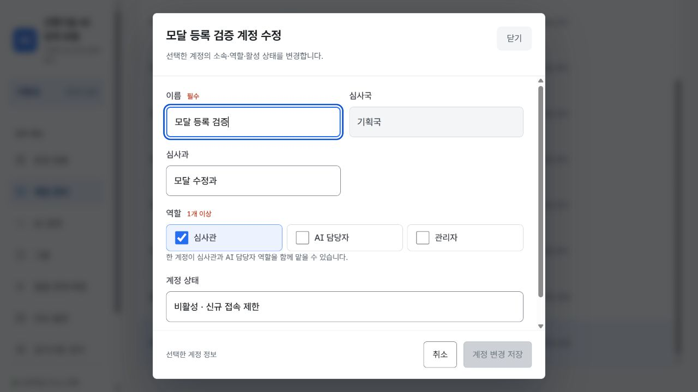
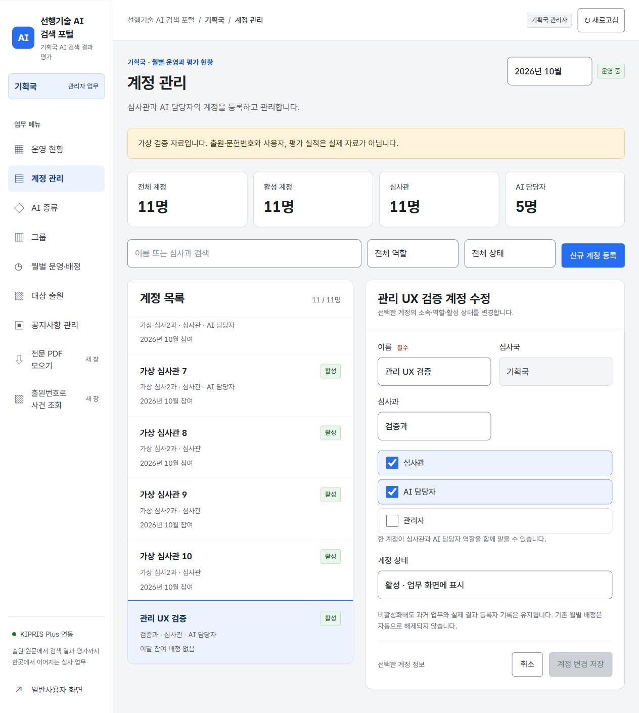

# 대상 출원 공개공보 PDF와 관리자 UX 개편

적용일: 2026-10-27. 담당 입력 업무의 출원번호와 다운로드 대상의 관계를 명시하고, 심사국 관리자 화면을 업무별로 재구성했다.

## 대상 출원 공개공보

- 목록의 각 행은 그 행의 `applicationNumber`를 전용 `TargetPublicationDownload`에 전달한다.
- 전용 버튼은 `numberType=application`, `kind=publication`으로 고정한다. 입력 중인 검색 결과 문헌번호나 다른 선택 출원, 등록공보 종류로 대체할 수 없다.
- 버튼 위에 대상 출원번호를 표시하고 접근성 이름에도 같은 번호와 공개공보 받기를 포함한다. 파일명과 오류 토스트도 요청한 출원번호를 따른다.
- AI 담당 상세 화면도 같은 출원의 공개공보 전용 버튼을 사용한다. 검색 결과 원문 수집과 구별하며, 심사관·기존 사건 조회의 공개·등록 원문 검토 기능은 유지한다.
- 목록에서 다른 출원의 PDF를 받아도 현재 선택 출원과 입력 중인 검색 결과는 바뀌지 않는다. 가상 자료는 실제 PDF를 요청하지 않는다.

## 관리자 화면

| 업무 | 개편 내용 |
|---|---|
| 운영 현황 | 그룹·담당 심사관별 범위 조회, AI 입력 대기·재확인·담당 배정 후속 업무 연결, 진행 상세, 현재 범위 6시트 엑셀, 마감·재개방 |
| 심사관 관리 | 위쪽 그룹·그룹원 카드와 추가·수정·삭제 모달. 아래쪽 심사관명·심사과·소속 그룹·권한·담당 AI 표. 이름 클릭 수정 모달에서 정보·그룹·AI 배정을 일괄 저장 |
| AI 종류 | ChatGPT·클로드 같은 실제 등록 이름을 큰 카드로 표시. 활성 상태·공통 배정 그룹 수, 검색·필터, 추가·수정 모달, 순위 비교 전용 방식 별도 영역 |
| 월별 운영 | 기한·선정 건수와 비교 AI의 2단계 설정. 심사관 배정과 분리. 여러 월의 동시 운영·개별 마감·재개방 지원 |
| 대상 출원 | 출원번호·담당자·CPC 검색, 상태·담당 심사관 필터, 선택한 출원의 상세 확인, 참여 심사관 대상 추가 등록·선정 취소 |

함께 추가된 공지사항 관리 연결을 보존했다. 심사국별 저장 공간·세션, 저장 충돌 시 입력 유지와 보관, 마감 제어, 기존 평가 규칙은 유지한다.

관리 준비상태 안내는 실제 참여 및 확정 출원의 그룹을 기준으로 한다. 미배정 상태의 월 설정도 기존 규칙대로 저장할 수 있다. AI 활성 상태를 바꾸는 것만으로 이미 정한 월별 비교 참여를 자동 해제하지 않는다.

## 설명 문구 정리 (2026-10-28)

제목·필드·버튼으로 알 수 있는 소개와 반복 지시를 덜어냈다. 기능과 업무 규칙은 유지한다.

| 대상 | 정리 |
|---|---|
| 공통 화면 | 제목 아래 반복 설명·분류 문구, 사이드바 홍보 문구, 로그인 하단의 반복 설명 삭제 |
| 심사관 관리 | 긴 소개 상자와 배정표의 동작 설명 삭제. 저장된 상태 안내는 생략하고 수정 중에만 미저장을 표시 |
| 계정·AI 모달 | 입력 지시와 반복 역할 설명 삭제. 필수 표시와 입력 필드·버튼을 남김 |
| 비활성 안내 | 비활성 상태를 선택했을 때만 기존 기록·배정 또는 월별 비교 설정 유지 안내를 짧게 표시 |
| AI 종류 | 소개 문단 대신 등록 수·상태·AI 카드 표시. 비교 전용 영역의 반복 설명 삭제 |
| 월별 운영 | 중복 마감 안내 삭제, 빈 기한·상한 0의 의미를 짧게 유지, 참여자 배정 안내 상자를 바로가기 버튼으로 축소 |
| 공지사항 | 게시 위치 설명과 긴 예시 축소. 내용을 비워 저장하면 공지가 내려간다는 안내 유지. 미저장 상태만 표시 |
| 출원 전문 | 다운로드 준비 지시문을 짧은 제목으로 변경. 대상 출원번호와 가상 자료의 다운로드 제한 유지 |

필수 조건, 평가의 미선택·0점 구분, 공개·확정의 영향, 저장 충돌·오류 복구와 PDF 대상 번호는 유지했다. 브라우저에서 심사관 목록·AI 카드·모달·공지 입력을 확인했고, 비활성 안내의 조건부 표시와 375px 모달의 가로 넘침 없음, 공지 입력의 접근성 설명 연결을 확인했다.

[간결해진 심사관 관리](concise-personnel.png) · [AI 종류](concise-ai-catalog.png) · [계정 모달](concise-account-modal.png) · [모바일 AI 모달](concise-ai-modal-mobile.png)

## 검증

- 심사관 관리에서 사용자 등록·수정과 이달 참여 그룹, 그룹별 AI 담당을 함께 관리한다. 기존 `accounts` 메뉴 저장 값도 `examiners` 탭으로 복원한다.
- 격리 자료에서 참여 그룹과 AI 담당자를 바꾼 뒤 계정 수정 모달을 열어 소속을 저장했다. 배정 초안이 유지되고 일괄 저장·다시 불러오기 후 두 배정 값이 유지됨을 확인했다.
- 검색 중 신규 계정을 등록하면 필터가 초기화되어 새 사용자가 보인다. 새 계정의 참여 그룹과 3개 AI 담당 업무를 함께 배정·저장하고 9/9 필요한 배정을 확인했다.
- 월별 운영에 참여·AI 담당 입력이 중복 노출되지 않는다. 운영 건수 설정을 저장해도 최신 참여·담당 배정이 유지된다. 두 저장 경로는 자신의 필드만 현재 월 설정에 합쳐 저장하며, 확정 출원의 기존 그룹은 유지한다.
- 검증 월 마감 시 모든 참여·AI 담당 선택이 비활성화되고 계정 모달은 계속 수정 가능함을 확인했다. 검증 후 운영 중으로 복원했다.
- 375px에서 페이지 가로 넘침 없이 사용자 목록이 한 열로 표시된다. AI 배정표만 자체 영역에서 가로 스크롤한다. 배정 변경 중 저장바 고정과 원래 값 복원 시 미저장 해제를 확인했다.

[통합 심사관 관리 화면](examiner-management.png) · [모바일 참여 그룹 입력](examiner-management-mobile.png)

- AI 종류는 ChatGPT·클로드 같은 검색 도구를 뜻하도록 안내한다. 실제 저장된 AI 이름을 카드로 표시하며, 추가·이름 변경·활성 상태 수정을 모달에서 처리한다.
- 격리 자료에서 Gemini 추가 후 검색 필터가 초기화되어 새 카드가 보이고, 월별 비교 AI 선택지에도 나타나는 것을 확인했다. 이름을 `Gemini 검증`으로 바꾸고 비활성 저장·필터 동작을 확인했다. 선행기술조사는 별도 비교 전용 영역을 유지한다.
- AI 추가·수정, 저장 실패 시 입력 유지·복구 안내, 미저장 확인, 저장 중 닫기 차단을 UI 테스트로 확인했다. 새 AI의 `kind=ai`와 기존 AI 식별자·비교 전용 방식 보존도 검증한다.
- AI 카드와 모달은 375px에서 가로 넘침이 없고, 모달 이름 필드에 초기 포커스가 간다. 공통 모달 스타일을 사용하는 계정 등록도 720px 너비·24px 체크 표시를 유지함을 확인했다.

[AI 종류 카드](ai-type-catalog.png) · [AI 종류 수정 모달](ai-type-modal.png) · [모바일 AI 모달](ai-type-modal-mobile.png)

- 계정 신규 등록과 기존 소속·역할·활성 상태 수정이 모달에서 저장되고 목록에 반영됨을 격리된 자료로 확인했다.
- 모달의 이름 필드 초기 포커스, Tab·Shift+Tab 순환, Escape 닫기 및 원래 항목으로 포커스 복원을 확인했다. 미저장 입력 취소와 저장 중 닫기 차단은 UI 테스트에서 검증한다.
- 동시 저장 충돌(409)을 실제로 재현했다. 모달이 열린 채 입력이 유지되고 오류 영역으로 포커스가 이동하며, 입력 보관·최신 자료 불러오기 버튼이 모달 안에 표시된다. 이 복구 버튼은 폼을 제출하지 않는다.
- 375×844 화면에서 가로 넘침 없이 모달 내용만 스크롤하고 저장·취소 버튼은 계속 표시됨을 확인했다.

- KRDS 기본 스타일에 가려진 관리 화면 체크 표시를 복원했다. 계정 역할의 24px 체크박스와 실제 체크 상태를 브라우저에서 확인했다.

- 관리자 UI·준비상태·국별 세션·대상 공개공보 테스트, 기존 평가·순위·저장 복구·전문 조회·엑셀 테스트 통과.
- 실제 격리 D1의 국별 분리·동시 저장·충돌·기존 공용 자료 보존 테스트 통과.
- PDF 관련 회귀 37개 및 전용 대상 클릭 검증 4개 통과. 서로 다른 두 대상의 URI·파일명과 공개공보 종류를 확인한다.
- 전체 TypeScript 검사 및 프로덕션 빌드 통과.
- 별도 `.wrangler/admin-ux-qa` 자료로 계정·AI·그룹 등록, 검색·역할 필터, 미저장 이동 취소, AI 추가 후 미배정 2건 표시, 미완성 월 저장, 6/6 담당 배정, 마감 월 읽기 전용 및 출원 검색·상세를 브라우저에서 확인했다.
- 실제 대상 `10-2020-0093844`의 공개공보 응답과 브라우저 다운로드 요청을 확인했다. 입력한 검색 결과 `KR1020220014141A1`, `US20230000001A1`은 대상 PDF 번호로 사용하지 않았다.
- 다른 미발행 대상의 오류 토스트가 해당 출원번호를 표시하고 선택·입력을 보존함을 확인했다.
- 375px 관리자 화면에서 페이지 가로 넘침이 없고, 계정 입력 폭이 화면 안에 들어온다. 월별 저장바는 변경 전 정적·변경 중 고정으로 확인했다. 표는 자체 영역에서 스크롤한다.

실기기·화면 읽기 프로그램 사용성 검증과 공개 배포는 수행하지 않았다. 검증 자료는 기존 운영 자료와 분리했다.

[모바일 계정 모달](account-edit-modal-mobile.png)

이전 전체 관리 화면:

[모바일 계정 관리](admin-ux-mobile.png) · [대상 출원 공개공보와 오류 안내](target-application-publication.png)

## 월별 운영과 공통 심사관 관리 분리 (2026-10-28)

- EvaluationState.personnel의 memberships와 assignments가 심사국 공통 배정이다. 관리자 전용 savePersonnel로 저장하며 마감 월에 종속되지 않는다.
- 기존 월의 참여·담당자 배열은 이관·감사 기록으로 보존한다. 공통 배정이 없는 자료만 월 ID 순으로 이관하고, 같은 계정/그룹×AI 조합은 최근 월을 우선한다. 명시적으로 비운 공통 배정은 과거 월에서 복원하지 않는다.
- saveMonth는 기한·건수·비교 AI만 변경한다. 기존 월 배정 배열의 수정 요청은 거절하고 공통 배정·확정 출원·공개 결과 작성자 기록을 보존한다. 비교 AI를 한 월에서 제외해도 다른 월의 공통 담당 배정은 삭제하지 않는다.
- 여러 운영 월을 동시에 열 수 있다. 월 목록에 상태와 출원·비교 AI 수, 선택·마감·재개방을 표시한다. 월별 선정·입력·평가·기한은 해당 월에만 적용한다.
- 공통 관리 화면(심사관·AI 종류·그룹·공지)은 월 선택과 마감 배너를 표시하지 않는다. 월이 없는 상태에서도 공통 관리를 사용할 수 있다.
- 검증: test-independent-operations.mjs, test-admin-guidance.mjs, 기존 평가/UI/PDF 테스트, 격리 D1의 이관·심사국 분리·월 설정/공통 배정 CAS 경합. localhost 가상 자료에서 10·11월 동시 운영 및 한 월의 마감 중 공통 배정 저장과 기록 보존을 확인했다.
- 화면: independent-personnel.png.

## 그룹 통합과 심사관 표·모달 편집 (2026-10-28)

- 별도 그룹 탭을 제거하고 심사관 관리 위쪽에 그룹·그룹원과 추가·수정·삭제를 배치했다. 이전 groups 메뉴 세션은 examiners로 이관한다.
- 아래쪽은 요청한 다섯 열의 표로 표시한다. 심사관명과 그룹원 이름은 수정 모달을 연다. 등록·수정은 saveExaminer 한 요청으로 기본 정보·소속 그룹·AI 담당 배정을 원자적으로 저장한다.
- 그룹×AI별 단일 담당자 규칙을 유지한다. 다른 담당자의 AI를 선택하면 변경 대상을 표시한다. AI 권한 해제 시 본인 배정을 해제하고, 비활성 계정에는 새 AI 업무를 배정하지 않는다.
- deleteGroup은 deletedAt을 기록해 현재 그룹 목록에서 제외하고 현재 소속만 해제한다. 출원 스냅샷·공개 결과 작성자·평가·월 설정은 보존한다. 확정 출원이 있으면 기존 AI 배정을 보존하고 삭제된 그룹의 기존 업무도 재배정할 수 있다. 미사용 배정은 정리한다.
- 새 삭제 확인창도 AccessibleDialog를 사용한다. 취소에 초기 포커스를 두고, 실패 시 모달 안에 서버 오류·입력 복구를 표시한다.
- 검증: test-examiner-management.mjs, 통합 UI·평가·월별 운영 회귀 테스트, 격리 D1의 단일 revision 저장·심사국 차단·실패 시 무변경. localhost 가상 자료에서 그룹 추가, 등록, 이름 클릭 수정, AI 배정, 그룹 삭제 후 미배정을 확인했다. 375px에서 모달과 저장 버튼이 화면 안에 유지되는 것을 확인했다.
- 화면: group-examiner-directory.png, examiner-directory-modal.png, examiner-directory-modal-mobile.png.
