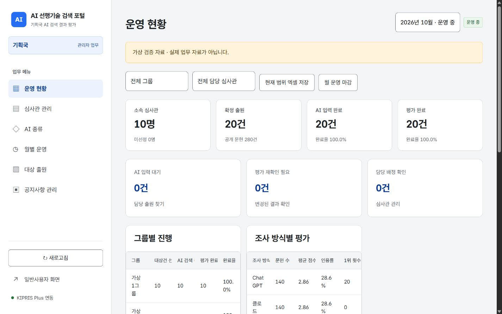
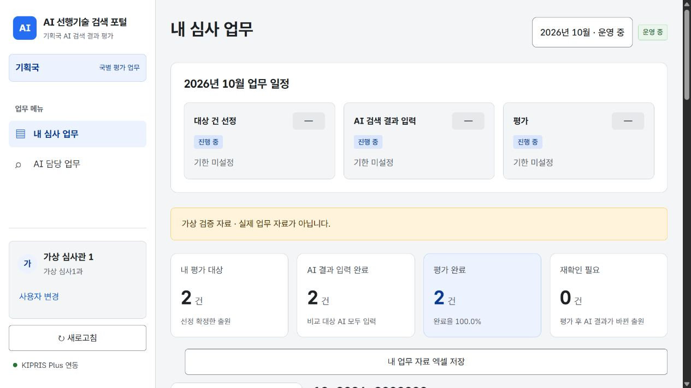
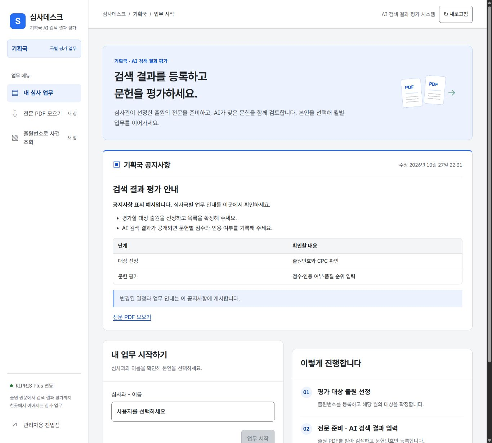
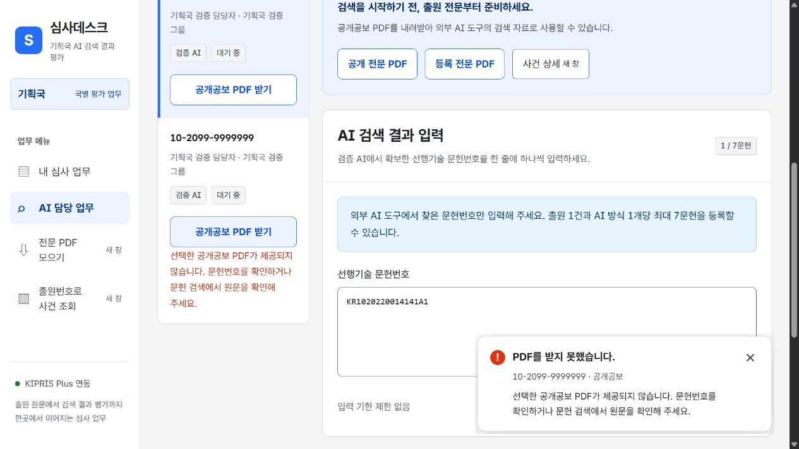

# 심사국별 업무와 계정 관리

## 주소

홈(`/`)에는 여섯 심사국으로 이동하는 링크만 표시한다. 업무·사용자 선택·평가·관리 기능은 해당 심사국 주소에서 사용한다.

| 심사국 | 일반 업무 | 계정·운영 관리 |
|---|---|---|
| 기획국 | `/기획국` | `/기획국/rhksfl` |
| 융합국 | `/융합국` | `/융합국/rhksfl` |
| 전기국 | `/전기국` | `/전기국/rhksfl` |
| 화학국 | `/화학국` | `/화학국/rhksfl` |
| 기계국 | `/기계국` | `/기계국/rhksfl` |
| 반도체단 | `/반도체단` | `/반도체단/rhksfl` |

`rhksfl`은 요청받은 관리자 주소다. 최초 진입 시 **심사관 관리**가 열린다. 화면에 표시되는 심사국, 사용자 선택, 계정의 소속, AI 종류와 공통 배정은 선택한 심사국을 따른다. 한글 주소의 원문·퍼센트 인코딩을 모두 처리하고, 지원하지 않는 심사국 주소는 404와 심사국 선택 링크를 표시한다.

각 심사국 초기 화면에는 공지사항과 **심사관 선택** 목록을 표시한다. 관리자 **심사관 관리**의 소속 그룹별로 활성 사용자를 묶고, 각 그룹 안에서 **심사과 - 심사관 이름**을 심사과·이름순으로 정렬한다. 소속 그룹이 없거나 삭제된 그룹에 속한 사용자는 마지막 **그룹 미배정** 목록에 표시한다. AI 담당자는 작은 배지로 구분하며, 이름을 누르면 바로 해당 사용자의 업무가 열린다. 관리자 진입 링크는 표시하지 않으며 위의 관리 주소로 직접 접근한다.

## 심사관 관리

심사관 관리와 그룹을 하나의 **심사관 관리** 탭으로 통합했다. 계정·소속 그룹·그룹별 AI 담당자는 심사국 공통 설정이며 운영월 선택이나 월별 참여 등록은 필요하지 않다.

신규 심사국에는 **그룹 1**, **그룹 2**를 기본으로 만든다. 기존 저장소도 아직 그룹이 없으면 한 번만 기본 그룹을 추가한다. 기존 그룹·그룹원·AI 담당 배정은 유지하고, 이후 직접 삭제한 기본 그룹은 다시 만들지 않는다.

위쪽 **그룹** 영역에서 현재 그룹과 그룹원 이름을 확인한다. **그룹 추가**와 그룹별 **수정**은 모달에서 처리하며, **삭제**는 확인 모달을 거친다. 그룹원 이름을 눌러도 해당 심사관의 수정 모달을 열 수 있다.

아래쪽 **심사관** 표에는 **심사관명·심사과·소속 그룹·권한·담당 AI**가 표시된다. 이름·심사과, 권한, 활성 상태, 소속 그룹으로 필터링한다.

1. **심사관 등록** 또는 표의 **심사관 이름**을 누른다.
2. 모달에서 이름·심사과·소속 그룹·권한·활성 상태를 수정한다.
3. AI 담당자 권한이 있으면 그룹×AI 표에서 담당 업무를 선택한다. 다른 심사관의 담당 업무를 선택하면 저장 전 담당자 변경 내역을 표시한다.
4. 저장하면 기본 정보·그룹·담당 AI가 한 번에 반영된다. 별도의 배정 일괄 저장은 필요하지 않다. 실패하면 입력을 유지하며 최신 자료 불러오기와 입력 보관을 사용할 수 있다.

그룹을 삭제하면 현재 목록에서 사라지고 그룹원은 미배정이 된다. 기존 확정 출원이 있는 그룹의 AI 담당 배정은 보존하므로 기존 업무·결과·평가·통계가 유지된다. 해당 배정은 표와 모달의 **기존 출원 그룹**에서 확인·변경할 수 있다. 기존 출원이 없는 그룹의 미사용 AI 배정은 해제된다. 모든 월이 마감돼 있어도 심사관 관리는 수정할 수 있다.

## 월별 운영과 동시 진행

**월별 운영**은 운영월·대상 건 선정·AI 검색 결과 입력·평가 단계의 표로 표시한다. 기본 운영월은 **2026년 11월·12월, 2027년 1월** 순서이며, 새 운영월의 세 단계는 모두 **시작 전**이다. 2026년 10월은 운영 표와 운영월 선택 목록에서 제외하고 입력을 차단한다. 기존 10월 출원·검색 결과·평가·배정 자료는 보존한다. 이전 기본값으로 남아 있던 미사용 운영월은 한 번만 시작 전으로 정리하고, 기존 업무 자료나 별도로 변경한 단계 상태는 유지한다. 단계별 드롭다운에서 **시작 전 / 진행 / 중지 / 마감**을 선택하면 바로 저장된다. 심사관과 AI 담당자는 해당 단계가 **진행**일 때만 자료를 입력·제출할 수 있다. 시작 전·중지·마감 상태에서는 기존 자료를 조회할 수 있지만 입력은 차단된다.

운영월을 누르면 기한 설정 모달이 열린다. 대상 건 선정은 그 달의 **첫째 금요일**, AI 검색 결과 입력은 **둘째 금요일**, 평가는 **셋째 금요일**을 기본 기한으로 설정한다. 날짜 변경은 즉시 저장되며 저장·되돌리기 버튼은 제공하지 않는다. 기존 기한은 보존하고, 이전 자료의 비어 있는 기한은 한 번만 기본값으로 보완한다. 관리자가 이후 기한을 지우면 빈 값도 유지한다.

업무 화면의 **운영월**에서 해당 월을 선택한다. 월별 출원·선정 확정·결과·평가·기한은 서로 분리된다. 한 월을 마감해도 다른 운영 월의 입력과 공통 심사관 관리는 계속할 수 있다. 저장 충돌은 기존 revision 비교로 감지한다.

운영월 드롭다운과 선택 월 표시는 단계 상태를 합산한다. 하나라도 **진행**이면 **운영 중**, 모두 **마감**이거나 이전 방식으로 월 전체가 마감되었으면 **운영 종료**, 그 외에 진행 단계가 없으면 **운영 전**으로 표시한다. 처음 진입할 때도 실제 진행 단계가 있는 운영월을 우선 선택한다.

단계 상태는 각 월과 단계에서 독립적으로 관리한다. 한 단계를 진행으로 바꿔도 다른 단계가 시작되지는 않는다. 기존 운영 상태는 보존하며, 별도로 월 전체가 마감된 이전 자료는 표에서 한 단계의 상태를 변경하면 해당 단계만 다시 열고 다른 단계는 마감 상태로 유지한다.

시작 상태에서 해당 단계의 입력·임시저장·제출을 허용한다. 중지·마감 상태에서는 해당 단계의 업무 입력과 제출을 차단하고 기존 자료 조회와 PDF 다운로드는 유지한다. 중지·마감한 단계는 **시작**으로 재개할 수 있으며, 다른 단계의 상태와 기존 선정·결과·평가는 바꾸지 않는다. 기한은 안내용이므로 날짜가 지났다는 이유로 자동 중지·마감하지 않는다. 관리자 대상 출원 추가·취소는 기존 운영 보정 기능으로 유지한다.

월 전체 마감은 모든 단계보다 우선한다. 월을 재개방해도 중지·마감해 두었던 단계의 상태는 유지되며, 필요하면 해당 단계를 따로 시작한다. 일반 일정 저장으로 단계 상태가 초기화되지 않는다. 상태는 기존 `evaluation_workspace` JSON의 운영월별 `stages`에 저장하므로 별도 테이블 변경이 필요하지 않다. 심사관 일정 카드와 단계별 입력 화면에도 현재 상태를 표시한다.

기존 월별 배정은 최근 월의 항목을 우선해 공통 배정으로 읽어들인다. 최근 월에 없는 계정·그룹×AI 조합은 이전 월의 항목을 유지한다. 다음 저장부터 공통 배정이 별도로 저장되며, 기존 월별 배정 원본과 출원·평가 기록은 보존한다. 월별 설정 저장은 공통 배정을 변경하지 않는다.

## AI 종류 추가

1. 해당 심사국의 `/rhksfl` 페이지에서 **AI 종류** 메뉴를 열고 **AI 종류 추가**를 선택한다.
2. 모달에서 ChatGPT·클로드 같은 AI 이름과 활성 상태를 입력해 **AI 종류 추가**로 저장한다.
3. **심사관 관리**에서 담당자 이름을 누르고, 모달의 **담당 AI**에서 그룹과 AI를 선택해 저장한다. 월별로 AI를 다시 선택할 필요는 없다.

추가한 AI 종류는 해당 심사국에만 표시되며 각 심사국이 독립적으로 관리한다. AI 입력 업무는 그룹별 담당 배정을 기준으로 생성한다. 심사관의 평가 대상은 **해당 출원에 공개된 AI 검색 결과와 선행기술조사 보고서**로 자동 결정한다. 초안·미납품 AI나 다른 출원의 결과는 비교하지 않는다. 일부 AI가 아직 납품하지 않았어도 공개된 문헌의 평가와 품질 순위를 마칠 수 있다. 이후 다른 AI 결과가 공개되거나 납품 문헌이 변경되면 재확인을 표시한다. AI 종류 등록이나 담당 배정만으로 기존 평가는 무효화되지 않는다.

AI 카드에서 수정 창을 열고 **AI 종류 삭제**를 눌러 확인하면 목록에서 삭제한다. 삭제된 종류에는 새 업무나 담당자를 배정할 수 없고, 다시 수정해 활성화할 수 없다. 이미 검색 결과가 있는 담당 업무와 공개된 결과·평가·통계는 보존한다. 삭제 전부터 배정된 담당자는 기존 결과를 유지·수정할 수 있고, 기존 배정 해제는 가능하지만 신규 배정·담당자 변경에는 사용할 수 없다. 삭제는 심사국별 관리자 동작이고 저장 revision 충돌 검사를 적용한다.

## 내 심사 업무의 월별 일정

업무 화면은 데스크톱에서 320px(좁은 데스크톱에서는 288px) 사이드바를 사용한다. 업무 메뉴, 사용자 이름·심사과와 **로그아웃**을 사이드바에 표시한다. 심사국 안내 상자, 새로고침 버튼과 KIPRIS Plus 연동 표시는 제거했다. 모바일에서는 같은 영역을 상단에 배치하며 로그아웃을 유지한다.





사용자를 선택해 **내 심사 업무**에 들어가면 상단에 선택한 운영월의 **대상 건 선정**, **AI 검색 결과 입력**, **평가** 기한과 D-day가 표시된다. 각 단계의 이름·진행 상태와 기한·D-day를 두 줄 안에 모으고 위아래 여백을 줄였다. 화면에 실제로 남은 너비에 따라 가로 요약과 압축된 세로 목록을 전환한다. 운영월을 바꾸면 해당 월의 설정으로 즉시 바뀐다. 날짜는 관리자 **월별 운영**에서 정한 값을 사용하며, 별도 일정 자료를 저장하지 않는다.

대상 건 선정의 출원번호 추가 입력은 **앞자리 2자리 - 출원연도 4자리 - 일련번호 최대 7자리**로 나뉜다. 숫자만 입력하고 앞자리·연도를 채우면 다음 칸으로 이동한다. **선정 목록에 추가**를 누르면 짧은 일련번호 앞에 0을 채운다. 예를 들어 `10 / 2026 / 123`은 `10-2026-0000123`으로 추가된다. 전체 출원번호 붙여넣기와 여러 건 일괄 붙여넣기도 사용할 수 있다. 출원을 한 건 추가하거나 여러 건을 목록에 추가하면 전체 선정 목록을 자동 저장하며, 입력 화면은 계속 열린다. 아직 확정하지 않은 목록은 임시저장하고, 이미 제출한 목록은 제출 상태를 유지한다. 저장 실패 시 추가한 행을 그대로 남기고 다시 저장하도록 안내한다. 행의 직접 수정·삭제는 기존 저장 버튼으로 저장한다.

선정을 확정한 뒤 평가 단계가 진행 중이 아니면 평가 입력 화면 대신 **제출한 출원 목록**을 보여준다. 선택한 운영월에 본인이 제출한 확정 출원번호·CPC·AI 검색 결과 입력 상태를 확인하고 업무 자료를 엑셀로 저장할 수 있다. 다른 사람의 출원, 다른 월의 출원, 초안·선정 취소 건은 포함하지 않는다. 관리자가 평가 단계를 시작하면 기존 평가 화면으로 전환하며, 아직 선정을 제출하지 않은 경우에는 대상 건 선정 화면을 유지한다.

**대상 건 선정**이 진행 중이면 제출 후에도 **제출 목록 수정**에서 출원번호·CPC 수정과 출원 추가·삭제가 가능하다. **수정 사항 저장**을 누르면 변경된 목록이 AI 담당 업무에 반영된다. 같은 출원은 기존 업무 식별자와 결과·평가·그룹 기록을 유지한다. 출원번호를 바꾸거나 삭제한 건은 취소 기록과 기존 결과·평가를 보존하고, 새 출원은 별도 업무로 등록한다. 선정 단계가 중지·마감되거나 월 전체가 마감되면 수정할 수 없으며, 관리자가 다시 시작·재개방하면 수정할 수 있다.

한국 날짜를 기준으로 남은 날은 `D-숫자`, 예정 기한 당일은 `D-day`, 지난 날은 `D+숫자`로 표시한다. 기한은 일정 안내용이며, 기한이 지나도 대상 건 선정·AI 검색 결과 입력·평가를 저장하고 제출할 수 있다. 관리자가 직접 마감한 월은 재개방해야 제출할 수 있다. 기한을 정하지 않은 항목은 **기한 미설정**으로 표시한다. 화면을 켜 둔 채 자정이 지나거나 탭으로 돌아와도 남은 일수를 갱신한다.

## 심사관 평가 총평

평가 단계의 **내 심사 업무**는 요약 카드 없이 **내 평가 대상 건** 목록을 표시한다. 출원을 선택하면 모달에서 **AI 문헌별 평가**, **조사 방식별 품질 순위**와 **총평**을 입력한다. 저장에 성공하면 목록으로 돌아가고, 실패하면 모달에 오류와 입력 내용을 유지한다. 저장하지 않고 닫을 때는 입력 폐기를 확인한다.

총평은 선택 입력이며, 비워 두어도 평가를 저장하고 완료할 수 있다. 최대 4,000자까지 여러 줄로 작성하고 **평가 저장**을 누르면 해당 출원의 평가와 함께 저장된다. 다시 열면 저장된 총평이 표시되며, 내용을 비워 다시 저장하면 삭제된다.

총평은 기존 평가와 같은 권한·운영월 마감·버전 충돌 제어를 적용한다. 총평의 조회 권한은 기존 평가 자료와 같다. AI 검색 결과가 바뀌어 순위를 다시 확인해야 하는 경우에도 총평은 유지한다. 기존 자료에 총평 필드가 없어도 정상 동작한다.

## 공지사항 관리

1. 해당 심사국의 `/rhksfl` 페이지에서 **공지사항 관리**를 선택한다.
2. **공지 내용**에 마크다운을 작성하고 옆의 **미리보기**에서 표시 결과를 확인한다.
3. **공지사항 저장**을 누르면 해당 심사국 초기 화면의 심사관 선택 목록 위에만 표시된다. 심사관·AI 담당자 계정의 업무 화면에서는 공지를 표시하지 않는다.
4. 내용을 수정해 다시 저장하거나, **공지 내리기**로 게시를 종료한다. 내용을 비워 저장해도 메인 페이지에서 공지가 사라진다. **변경 취소**는 작성 중인 내용을 마지막 저장 상태로 되돌린다.

각 심사국은 하나의 공지 영역을 관리한다. 공지는 운영월과 무관하며 마감된 월에도 수정할 수 있다. 제목, 강조, 목록, 링크, 인용문, 코드, 표, 체크리스트를 지원하고 최대 20,000자까지 작성할 수 있다. HTML과 실행 가능한 URL은 차단하며 이미지 구문은 대체 텍스트로 표시한다. 미리보기와 메인 페이지는 같은 마크다운 렌더러를 사용한다.

공지는 기존 심사국별 `evaluation_workspace`의 `notice` 필드에 마크다운 원문과 수정 시각으로 저장한다. 기존 자료에 이 필드가 없어도 정상 동작하며, 공용 업무의 공지를 다른 심사국으로 복사하지 않는다. 관리자용 저장 권한과 버전 충돌 검사를 적용하고, 저장 실패 시 작성 중인 내용은 유지한다. 마지막 수정 시각은 한국 시간으로 표시한다.

별도 `.wrangler/notice-qa` 저장소의 브라우저 검증에서 마크다운 미리보기·저장·다시 불러오기·기획국 메인 표시와 융합국 미표시를 확인했다. 예시 화면의 내용은 이 검증 저장소에만 등록했다. 공지 저장·권한·초기 자료 호환·심사국 분리·동시 저장 충돌, 렌더러 보안과 편집 동작 테스트, TypeScript 검사와 프로덕션 빌드를 통과했다.



[공지사항 관리 화면](bureau-notice-admin.png)

## AI 담당자의 공개공보 PDF

AI 검색 결과에는 특허번호뿐 아니라 논문 제목·서지정보, DOI, 원문 URL도 한 줄에 한 문헌씩 등록할 수 있다. 한 문헌은 최대 2,000자이며 출원·AI 방식별 최대 7문헌 제한은 같다. 심사관의 **AI 문헌별 평가**와 AI 담당자의 **심사관에게 공개된 결과**에서 같은 문헌 링크를 사용한다.

국내 공개번호 `KR1020200000000A`는 검색할 때 권리구분 `10`을 빼서 `KR20200000000A`로 변환한다. 이미 변환된 공개번호·등록번호·해외 번호는 해당 형식에 맞게 검색하고 저장된 원문은 유지한다. 논문 제목과 서지정보는 Google Scholar에서 검색하며, DOI와 HTTP(S) 원문 URL은 해당 문헌을 연다. 논문은 특허 PDF 수집 목록에서 제외하고 문헌 링크에서 확인한다.

AI 담당 업무의 대상 출원마다 **공개공보 PDF 받기**를 제공한다. 대상 선택 버튼과 PDF 버튼은 별개이므로 다른 출원의 입력을 작성하면서도 목록의 PDF를 받을 수 있다. 목록 버튼은 파일명 입력 없이 브라우저 다운로드 설정을 사용한다. AI 담당 상세 화면도 같은 대상 출원의 공개공보만 받는다. 심사관 상세·기존 사건 조회의 공개·등록 원문 검토 버튼은 기존 동작을 유지한다.

PDF를 처음 받으면 KIPRIS Plus에서 검증한 PDF 본문을 D1에 저장한다. 다음 다운로드는 브라우저를 다시 열거나 다른 담당자가 요청해도 저장본을 사용하며, KIPRIS PDF 정보·파일 조회 및 API 호출량을 추가하지 않는다. 번호의 공백·붙임표 차이는 같은 번호로 처리하고 공개공보와 등록공보는 분리한다. 일시적인 오류나 제공되지 않는 공보는 저장하지 않는다.

AI 담당 업무의 **전체 공개공보 ZIP 받기**는 선택한 월에 배정된 전체 출원을 대상으로 한다. 입력 대기 필터와 관계없이 입력 완료 건도 포함하며 같은 출원이 여러 AI 업무에 중복되어도 한 번만 넣는다. **원본 다시 조회**를 선택하면 KIPRIS에서 다시 받아 저장본을 갱신한다. 갱신 실패 시 기존 저장본은 유지하고, 해당 건의 실패 사유를 표시한다. 일부 공보가 없으면 나머지 PDF와 `다운로드 결과.txt`를 ZIP에 담는다. 수집·압축 중에는 중단할 수 있으며, 중단하면 ZIP 저장을 진행하지 않는다.

저장은 `patent_document_cache`의 파일 정보와 `patent_document_chunks`의 PDF 조각으로 나눈다. [D1의 행 크기 제한](https://developers.cloudflare.com/d1/platform/limits/)을 지키도록 512 KiB씩 나누어 Base64로 보관하며, 다운로드할 때는 작은 묶음으로 읽어 스트리밍한다. 파일 정보와 조각은 [D1 batch 트랜잭션](https://developers.cloudflare.com/d1/worker-api/d1-database/#batch)으로 함께 갱신한다. 교체한 이전 버전은 진행 중인 다운로드를 위해 최소 한 시간 유지하고 다음 갱신 시 오래된 조각을 정리한다. 신규 테이블은 런타임에서 자동 생성하며 `migrations/0003_patent_document_cache.sql`에도 같은 스키마를 둔다. API 키와 외부 PDF 주소는 보관하지 않는다.

PDF는 기존 KIPRIS Plus 프록시에서 원문 형식과 번호를 검증해 받는다. 해외 문헌·공개되지 않은 문헌 등의 오류는 문헌번호와 한국어 복구 안내가 포함된 토스트와 버튼 옆 안내로 표시한다. 토스트는 자동으로 사라지지 않으며 닫기 버튼으로 지울 수 있다. 반복 오류는 새 알림으로 표시하되 최대 3개를 유지한다. 저장 대화상자에서 취소하거나 페이지를 떠난 경우에는 오류 토스트를 띄우지 않는다. 가상 검증 자료의 번호는 실제 PDF를 요청하지 않는다.

## 저장 범위와 기존 자료

- API는 `GET/POST /api/evaluation?bureau={심사국}`으로 현재 범위를 전달한다. 본문의 다른 소속 값으로 범위를 바꿀 수 없다.
- D1의 기존 `evaluation_workspace` 테이블에 `bureau:{심사국}`별 행을 둔다. 계정·그룹·AI 종류·운영월·출원·결과·평가·수정 버전이 서로 독립적이다. 다른 심사국의 저장은 현재 심사국의 저장 충돌을 만들지 않는다.
- 다른 심사국 사용자 ID로 조회·수정하는 요청과 다른 심사국 소속으로 계정을 저장하는 요청을 거절한다.
- 기존 공용 자료의 `main` 행과 `/`, `/admin`은 보존한다. 각 심사국 공간을 처음 만들 때 기존 계정의 심사국과 출원 소속이 정확히 일치하는 자료만 복사한다. 소속이 불명확한 자료는 기존 공용 업무에 남는다. 최초 복사 이후에는 심사국별로 독립 관리하며 공용 자료와 자동 동기화하지 않는다.
- 다른 심사국 담당자의 비공개 초안·계정 정보는 가져오지 않는다. 해당 출원에 공개된 결과는 유지하되 타국 등록자 정보는 복사하지 않는다.
- 사용자·운영월·현재 메뉴·선택 출원·AI 필터의 세션을 심사국별로 분리한다. 심사국 전환 직후에는 이전 심사국 자료를 숨기고, 전환 전에 시작한 조회·저장 응답을 무효화한다. 입력 보관과 엑셀 파일에도 심사국 이름을 포함한다.

## 검증

지원하는 사용자·관리자 주소 12개와 잘못된 주소의 404를 로컬 HTTP로 확인했다. 별도 `.wrangler/bureau-qa` 저장소에서 기획국 검증 계정·AI·출원을 만들고 융합국에 나타나지 않는 것을 확인했다. 기존 업무 자료에는 검증 데이터를 추가하지 않았다.

```powershell
node scripts/test-bureau-routing.mjs
node scripts/test-bureau-workspace-ui.mjs
node scripts/test-evaluation-storage.mjs
node scripts/test-notice-storage.mjs
node scripts/test-notice-markdown.mjs
node scripts/test-notice-manager.mjs
node scripts/test-literature-link.mjs
node scripts/test-literature-input.mjs
node --test --experimental-strip-types scripts/test-pdf-feedback.mjs scripts/test-document-jobs.mjs scripts/test-patent-document.ts
```

기존 평가 규칙·순위 안내·세션 복구·전문 조회·엑셀 테스트와 전체 TypeScript 검사, 프로덕션 빌드도 통과했다.

브라우저에서 `/기획국/rhksfl`의 사용자 관리 기본 진입과 고정 심사국, 새 AI 종류 저장을 확인했다. AI 목록에서 실제 출원 `10-2020-0093844`의 공개공보 PDF 응답 200과 브라우저 다운로드 요청 안내를 확인했고, QA용 미발행 번호의 404에서는 문헌번호·복구 안내를 포함한 토스트를 확인했다. 비선택 PDF 요청에도 작성 중 입력과 선택 출원이 유지된다.

375px 화면에서 페이지 가로 넘침이 없고 토스트가 화면 안쪽 12px 여백을 유지하는 것을 실측했다. 닫기 버튼은 44px이며 Enter로 닫으면 해당 문헌의 PDF 버튼으로 초점이 돌아간다. 실기기·화면 읽기 프로그램 사용성 검증과 공개 배포는 별도로 수행하지 않았다.



[모바일 오류 토스트 확인 이미지](bureau-ai-pdf-toast-mobile.png)
