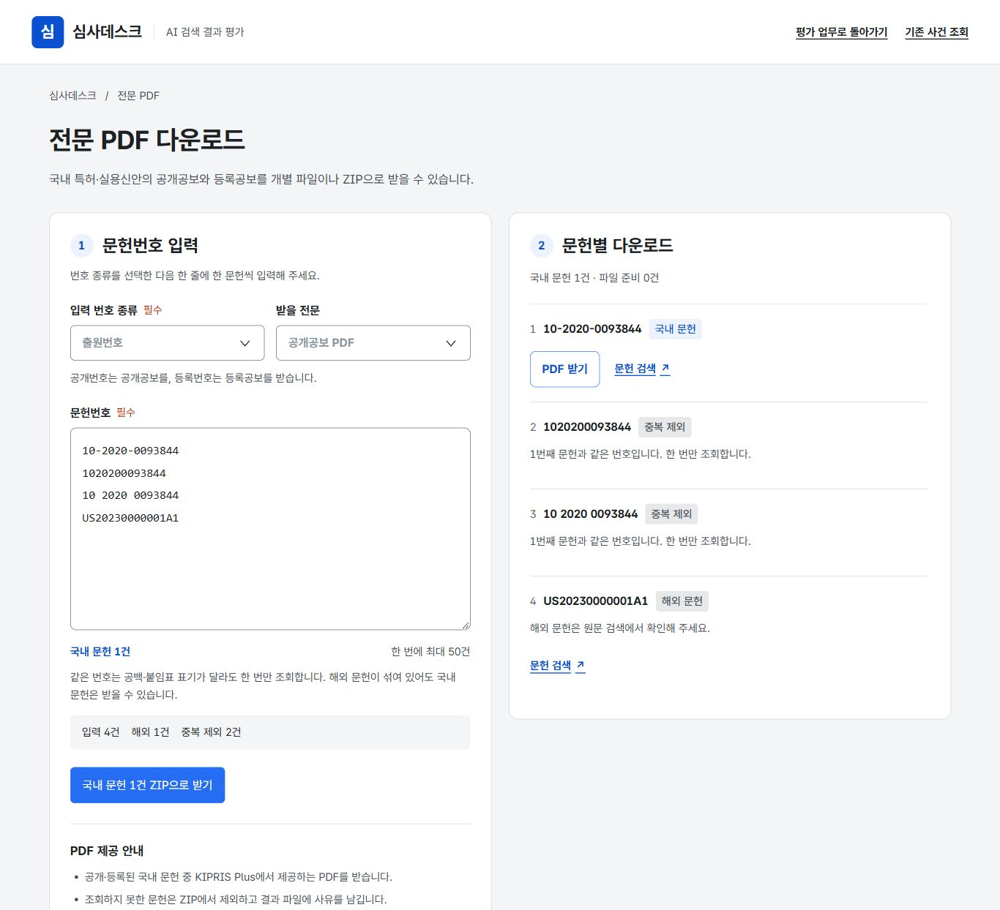

# KRDS UI·UX 수정 결과

수정일: 2026-10-27

사용자가 지정한 [KRDS HTML Component Kit](https://github.com/KRDS-uiux/krds-uiux)을 실제 프로젝트 의존성 `krds-uiux@1.1.0`으로 추가했다. 저장소에는 `SKILL.md` 형식의 별도 스킬이 없어 공식 토큰·CSS·HTML 컴포넌트 예제를 기준으로 적용했다. 기존 `UI_UX_REVIEW.md`는 수정 전 점검 기록이며 현재 수정 상태는 이 문서를 따른다.

## 적용한 디자인 기준

- 루트에서 공식 `resources/css/component/output.css`를 가져와 토큰·컴포넌트를 연결했다.
- 공식 primary `#256ef4`, 회색·정보·성공·경고·오류 토큰으로 화면을 통일했다. 기존 사건 조회의 색상 별칭도 공식 토큰으로 연결했다.
- 패키지의 Pretendard GOV 글꼴을 로컬 자산으로 제공한다. 작업 화면 본문은 17px, 표·밀도 높은 설명은 15px를 기본으로 한다.
- 주요 입력·버튼은 높이 48px를 적용했다. 고밀도 보조 버튼은 최소 44px를 유지한다. 포커스 테두리·본문 바로가기·표 제목·열 헤더·선택 상태를 보완했다.
- 데스크톱의 왼쪽 업무 메뉴·출원 목록·평가 본문 구조를 유지하고, 좁은 화면에서는 한 열과 영역 내부 스크롤로 전환한다.
- `krds-foundation.css`는 기존 스타일과 공식 토큰 사이의 연결·공통 접근성 규칙을 담당한다. `evaluation.css`와 `documents.css`는 해당 업무의 레이아웃을 담당한다.

KRDS의 공식 적합성 인증이나 모든 보조기기 검증이 완료되었다는 의미는 아니다. 이 프로젝트의 업무 흐름을 유지하면서 공식 키트의 디자인·컴포넌트 체계를 적용한 결과다.

## 이전 점검 사항의 처리

| 항목 | 수정 결과 |
|---|---|
| 잘못된 번호가 다른 출원으로 대체됨 | 원래 입력을 유지한 오류·재조회 화면으로 변경했다. 문서 제목도 본문의 입력 상태와 맞춘다. 샘플은 `demo=1` 또는 샘플 보기의 명시적 선택에서만 연다. |
| 번호 표기 차이의 중복·ZIP 덮어쓰기 | 번호 종류와 정규화한 번호로 중복을 제거한다. 원래 표시는 유지하고 ZIP 파일명은 정규화 번호·번호 종류·공보 종류로 고유하게 만든다. |
| 충돌 후 입력 보존 | 저장 실패 시 편집값과 기준 revision을 그대로 유지한다. 현재 입력을 JSON으로 보관할 수 있고, 입력을 버리고 최신 자료로 바꾸는 동작은 별도 확인 후에만 실행한다. 오래된 평가에 최신 결과 버전을 임의로 붙이거나 자동 병합하지 않는다. |
| PDF 수집과 평가 업무의 연결 | 자료 수집·사건 상세 링크를 새 창으로 열어 작성 중인 편집기를 보존한다. 사용자·운영월·메뉴·선택 출원은 해당 탭의 세션에 저장하고 새로고침 후 복원한다. 새 창임을 문구·접근성 이름으로 전달한다. |
| 국내·해외 혼합 문헌 전체 차단 | 국내·해외·형식 오류·번호 종류 미선택·중복을 행별로 구분한다. 받을 수 있는 국내 문헌은 계속 수집하고 해외 문헌에는 검색 경로를 제공한다. |
| AI 전담자의 첫 화면 | 심사관 역할이 없는 AI 담당자는 AI 담당 업무로 바로 진입한다. |
| 사용자 관리의 키보드 접근 | 사용자 이름을 실제 버튼으로 제공하고 선택 상태·표 제목·열 헤더를 보완했다. 화면 위치에 의존하는 안내를 작업 중심 문구로 바꿨다. |
| ZIP 생성·저장 중 중단 | 수집·압축·저장 단계를 나눈다. 수집과 압축 중 취소하면 파일 쓰기로 진행하지 않는다. 저장을 시작한 뒤에는 중단 버튼을 제공하지 않고 실제 저장 결과를 안내한다. |
| 마감 월 설정 | 마감 월의 입력을 잠그고 운영 재개방 경로를 제공한다. 마감·기한·동시 수정의 오류 안내를 구분한다. |
| 읽기 화면과 공보 PDF의 혼동 | 출력 버튼을 ‘읽기 화면 인쇄·PDF 저장’으로 변경하고 별도로 공보 원문 PDF를 제공한다. |
| 오류 복구·구현 용어 노출 | 사건 조회 오류를 지속 표시하고 재조회 경로를 제공한다. 새 조회가 실패했을 때 이전 사건을 현재 결과처럼 표시하지 않는다. PDF 오류는 한국어 복구 문구로 바꾼다. D1·Worker Secret 등 구현 설명을 일반 업무 안내에서 덜어냈다. |
| 반복 PDF 버튼의 이름 | 문헌번호·공개/등록공보 종류·받기 동작을 포함한 접근성 이름을 제공한다. |

현재 월 참여 목록에서 빠졌더라도 기존에 담당한 출원은 계속 접근할 수 있도록 신규 선정 자격과 기존 담당 건 접근을 분리했다. 기존 선정·결과 공개·0점/X·재확인·품질 순위 규칙과 KIPRIS API 계약은 유지한다.

## 검증 결과

- 전체 TypeScript 검사 통과.
- 전체 배포 빌드 통과. 공식 CSS·아이콘·글꼴 자산이 빌드에 포함됨.
- 평가 회귀: 20출원·40결과 묶음·280문헌, 초안 비공개, 0점/X, 재확인, 권한 범위, 마감·기한 검증 통과.
- PDF 작업 회귀 11개: 정규화 중복, 국내·해외 혼합, 공보 기호와 번호 종류 불일치, 고유 파일명, 수집·실제 JSZip 압축 중 취소, 저장 전 차단, 오류 안내, 네이티브 저장 취소·브라우저 대체 저장 검증 통과.
- 기존 PDF API 회귀 10개 통과.
- 전문 번호·시작 화면 회귀: 원래 입력 유지, 잘못된 번호의 실제 렌더, 명시적 샘플 분기 검증 통과.
- 사용자 위치 회귀: 역할별 시작·잘못된 세션 값·마감/기한/충돌 안내 구분 검증 통과.
- 기존 엑셀 회귀: 식별번호·0점·빈 값·수식 실행 방지·저장 취소 검증 통과.

실제 브라우저에서는 다음을 확인했다.

1. 같은 출원의 세 표기와 해외 문헌을 함께 넣었을 때 국내 1건·해외 1건·중복 제외 2건으로 표시하고 국내 다운로드를 허용한다.
2. 잘못된 번호 `123`은 다른 출원 없이 원래 값과 재조회 안내를 표시한다.
3. AI 업무의 두 번째 출원에서 작성 중인 문헌번호를 유지한 채 PDF 새 창이 열린다.
4. 임시저장 후 새로고침하면 사용자·AI 업무 메뉴·선택 출원·저장한 초안을 복원한다.
5. 대화상자 초기 포커스, Shift+Tab 순환, Escape 닫기, 열기 버튼 복귀가 정상이다.
6. 모바일 390px 뷰포트에서 PDF 입력·버튼을 확인했다. 평가 화면에서 발견한 전체 페이지 가로 넘침을 수정한 뒤 실제 콘텐츠 너비와 스크롤 너비가 같음을 확인했다.
7. 주요 평가 버튼의 실제 높이 48px, 글자 15~16px, 본문의 Pretendard GOV 적용, 공식 primary 토큰을 확인했다.

실제 KIPRIS 공개공보 PDF 조회는 HTTP 200, `application/pdf`, 1,277,965바이트로 정상이다. 같은 출원의 전문 XML도 HTTP 200과 `isDemo:false`로 조회되어, 실데이터 요청이 샘플로 대체되지 않음을 확인했다. 검증은 `.wrangler/krds-ux`의 분리된 가상 업무 데이터에서 진행했다.

## 변경 파일

모바일 화면: [PDF 입력 화면](krds-pdf-mobile.png).

- `app/layout.tsx`, `app/krds-foundation.css`, `package.json`, `package-lock.json`
- `app/evaluation/workspace.tsx`, `app/evaluation/evaluation.css`, `app/lib/workspace-location.ts`
- `app/documents/page.tsx`, `app/documents/documents.css`, `app/lib/document-jobs.ts`
- `app/components/pdf-download.tsx`, `app/components/pdf-download.css`, `app/lib/save-file.ts`
- `app/patent/page.tsx`, `app/fulltext/page.tsx`, `app/fulltext/fulltext-viewer.tsx`, `app/api/patent/fulltext/route.ts`
- `app/components/accessible-dialog.tsx`, `app/lib/patent-number.ts`
- `scripts/test-document-jobs.mjs`, `scripts/test-workspace-location.mjs`, `scripts/test-patent-navigation.mjs`

새 입력 JSON 보관은 수동 비교를 위한 자료다. 자동 병합·자동 재평가를 제공하지 않는다. 화면 읽기 프로그램과 모바일 실기기 전수 검증은 추가 확인 대상이다. 현재 변경은 로컬 프로젝트에 반영된 배포 전 상태다.
