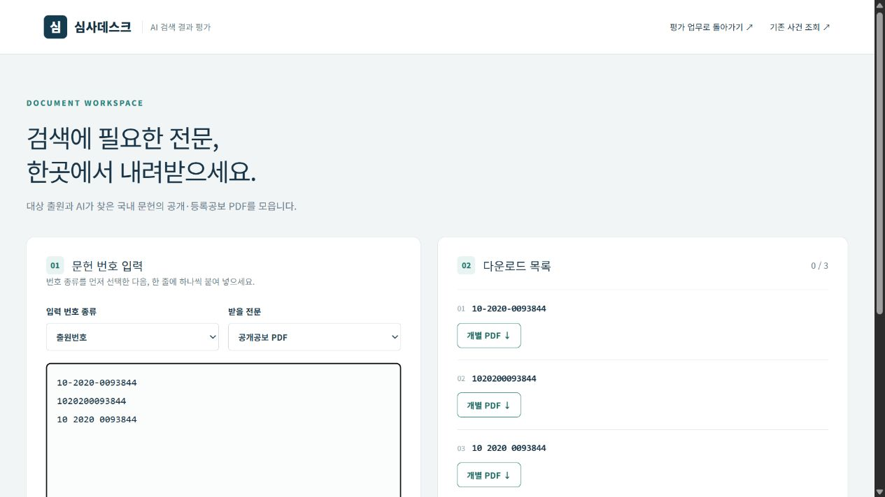
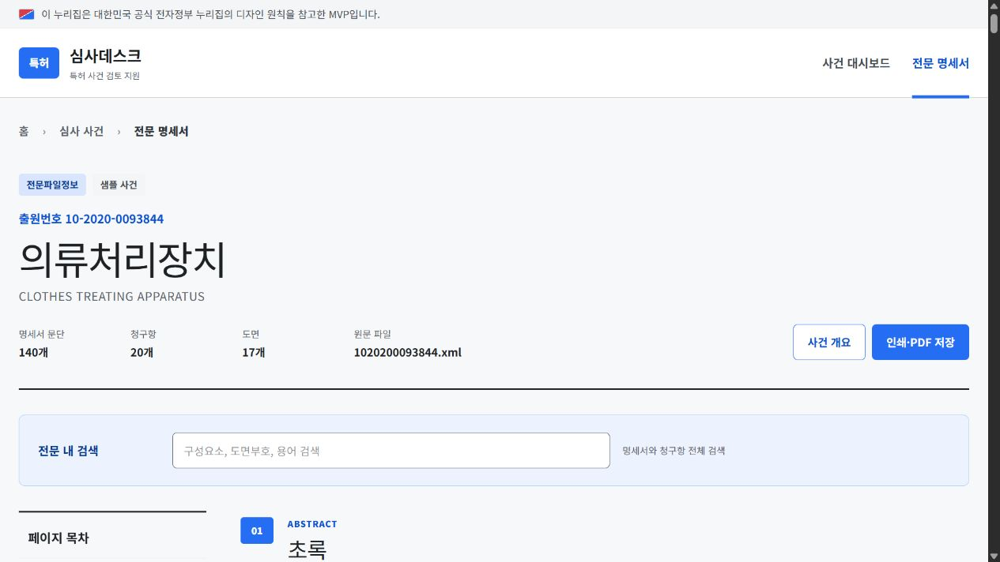

# 선행기술 AI 검색 포털 UI·UX 점검 결과

> 적용 완료: 아래 수정 제안은 사용자 요청에 따라 반영했다. 최신 상태와 검증 결과는 [UX 라이팅 점검안 적용 결과](UX_WRITING_APPLIED.md)를 참고한다. 아래 본문과 재현 이미지는 수정 전 점검 기록이다.

최초 점검일: 2026-10-27 · 최초 판정: **조정 필요**

개편한 평가 업무, 전문 PDF 수집, 기존 사건 조회와 전문 읽기 화면을 점검했다. 업무를 중단시키거나 다른 문헌을 보게 만드는 동작을 먼저 고치고, 그 동작에 맞춰 안내·버튼 문구를 정리할 것을 제안한다. 이번 점검에서는 앱 코드를 변경하지 않았다.

## 기준과 확인 범위

- 요청한 [Toss ux-writing SKILL.md](https://github.com/toss/apps-in-toss-harness/blob/main/packages/agent-plugin/shared/skills/ux-writing/SKILL.md)의 사용자 작업 중심, 사실에 맞는 표현, 원인과 다음 행동, 명확한 버튼, 조건 분리, 반복 제거, 말투·언어 일관성을 적용했다.
- 스킬이 참조하는 [quality-bar.md](https://github.com/toss/apps-in-toss-harness/blob/main/packages/agent-plugin/shared/skills/design/references/quality-bar.md)의 상태·문구·조작성·닫기 흐름도 함께 참고했다. 이 문서는 해당 프로젝트의 자체 기준이며 앱인토스 공식 규격 인증은 아니다. 이 사이트에 적용되지 않는 미니앱 등록·컨테이너 조건은 평가하지 않았다.
- 모든 대상 화면의 코드와 정적 문구를 수집했다. 로컬 브라우저에서 동일 번호의 표기 차이, 평가 업무와 PDF 수집 간 왕복, 잘못된 출원번호의 전문 읽기를 직접 재현했다.
- 기존 업무 데이터와 분리된 `.wrangler/ux-review` 저장소의 가상 자료로 확인했다. 기존 사용자·출원·평가 자료는 수정하지 않았다.
- 실제 파일 다운로드를 추가로 반복하지 않고 번호 처리와 ZIP 파일명은 메모리에서 재현했다. 중단 타이밍·마감 월·저장 충돌·키보드 문제는 코드로 확인했으며, 별도의 실제 사용자 테스트를 실시했다고 주장하지 않는다.

## 우선 수정할 동작

높음은 다른 출원을 읽거나 입력·파일 결과가 안내와 달라질 수 있는 항목이다. 보통은 업무 흐름·접근성·오류 복구를 방해하는 항목이다.

| 순서 | 중요도 | 확인한 문제 | 영향과 수정 방향 | 근거·확인 방법 |
|---|---|---|---|---|
| 1 | 높음 | 잘못된 번호로 다른 출원의 전문이 열림 | `/fulltext?applicationNumber=123`에서 제목은 `123 전문 명세서`지만 본문은 `10-2020-0093844` 샘플 사건이다. 샘플 배지는 있으나 입력 오류 안내가 없다. 잘못된 입력은 그 입력 그대로 오류 화면에 남기고, 샘플은 사용자가 명시적으로 선택할 때만 연다. | `app/fulltext/fulltext-viewer.tsx:73` · `app/fulltext/page.tsx:19` · 브라우저 재현 |
| 2 | 높음 | 같은 출원번호를 여러 번 수집하고 ZIP 파일명이 충돌함 | `10-2020-0093844`, `1020200093844`, `10 2020 0093844`를 3건으로 표시·요청한다. 마지막 두 파일명은 같아 ZIP에서 덮어쓴다. 성공 3건에 파일 2개가 될 수 있다. 번호 종류와 정규화한 번호로 중복을 제거하고 실제 파일 수를 센다. 원래 표기는 화면에 보존한다. | `app/documents/page.tsx:29`, `:51` · 브라우저 3행 확인 · JSZip 메모리 재현: 요청 3/파일 2 |
| 3 | 높음 | 저장 충돌의 복구 안내가 입력 보존을 보장하지 못함 | 오류 안내는 최신 자료 확인 후 다시 저장하도록 하지만 새로고침 승인 후 편집기는 재생성된다. 안내를 따라가며 저장 전 입력을 잃을 수 있다. 최신 자료를 별도로 가져오고 편집값을 유지·비교·재시도하도록 한다. 그 전까지는 복사·보관 절차를 명시한다. | `app/evaluation/workspace.tsx:49`, `:74`, `:96` · 코드 확인 |
| 4 | 보통 | PDF 수집 후 사용자·작업 위치가 초기화됨 | AI 담당 업무에서 검색 문헌 PDF 모으기로 갔다가 평가 업무로 돌아오면 사용자 선택부터 다시 해야 한다. 사용자·운영월·메뉴·선택 출원·저장 전 입력을 보존하거나 자료 수집을 별도 패널/탭으로 연다. | `app/evaluation/workspace.tsx:31`, `:157` · `app/documents/page.tsx:70` · 브라우저 왕복 재현 |
| 5 | 보통 | 해외 문헌 하나가 국내 문헌 수집도 막음 | AI 결과는 KR·US·EP 혼합 입력을 안내하지만 PDF 화면은 한 행이라도 국내 형식이 아니면 전체 수집을 막는다. 받을 수 있는 국내 문헌과 해외·형식 오류 문헌을 행별로 나누고 국내 수집은 계속 허용한다. | `app/documents/page.tsx:36` · `app/evaluation/workspace.tsx:157` · 현재 검증식 메모리 재현 |
| 6 | 보통 | AI 전담자의 첫 화면이 본인 업무와 맞지 않음 | 심사관 역할이 없는 AI 담당자도 시작하면 내 심사 업무를 먼저 보고 ‘심사관 역할이 배정되지 않았습니다’를 읽게 된다. 역할에 맞는 첫 업무로 이동시킨다. | `app/evaluation/workspace.tsx:92`, `:110` · 코드 확인 |
| 7 | 보통 | 관리자 사용자 목록을 키보드로 선택할 수 없음 | 기존 사용자 행이 클릭 가능한 `tr`이고 키보드로 조작할 버튼이 없다. 이름을 실제 버튼으로 바꾸고 현재 선택을 전달한다. ‘오른쪽’이라는 설명도 좁은 화면의 상하 배치와 맞지 않는다. | `app/evaluation/workspace.tsx:206` · 코드 확인 |
| 8 | 보통 | ZIP 생성·저장 중에도 중단 버튼이 남음 | 마지막 취소 확인 이후 압축·쓰기를 진행하면서 중단 버튼은 계속 보인다. 해당 단계에서 눌러도 저장을 막지 못한다. 수집/압축/저장 단계를 나누고 실제 취소 가능한 동작만 제공한다. | `app/documents/page.tsx:61`, `:65`, `:70` · 코드 확인 |
| 9 | 보통 | 마감한 월에서도 운영 설정 입력·저장이 활성임 | 입력을 마친 뒤 서버가 마감 월 저장을 거절한다. 공통 409 안내에는 최신 자료 새로고침이 붙어 해결 경로도 어긋난다. 마감 상태를 입력 전에 보여주고 재개방 경로를 안내한다. | `app/evaluation/workspace.tsx:198`, `:199`, `:74` · 코드 확인 |
| 10 | 보통 | 공보 원문 PDF와 읽기 화면 PDF가 구별되지 않음 | 전문 읽기의 ‘인쇄·PDF 저장’은 XML로 재구성한 읽기 화면을 출력한다. 공보 원문을 받는 동작과 구별해 ‘읽기 화면 인쇄·PDF 저장’으로 표시하고 원문 다운로드 링크를 제공한다. | `app/fulltext/fulltext-viewer.tsx:188` · 브라우저 버튼·코드 확인 |
| 11 | 보통 | 오류를 읽고 복구할 시간이 부족하거나 다음 행동이 없음 | 기존 사건 조회 오류가 3.2초 후 사라진다. PDF 오류에는 HTTP·파일 경로·서버 설정 등 담당자가 해결하기 어려운 용어가 나온다. 오류를 해당 입력 옆에 유지하고 다시 조회/관리자 문의 등 실행 가능한 다음 행동을 제공한다. 확인되지 않은 원인은 지어내지 않는다. | `app/patent/page.tsx:365` · `app/components/pdf-download.tsx:21` · 코드 확인 |
| 12 | 보통 | 반복 PDF 버튼의 읽기 이름에 문헌번호가 없음 | 버튼만 탐색하면 ‘개별 PDF’가 반복된다. 화면의 짧은 라벨은 유지하되 접근성 이름에는 문헌번호·공보 종류·동작을 넣는다. | `app/documents/page.tsx:70` · `app/components/pdf-download.tsx:46` · 접근성 트리·코드 확인 |

## 문구 수정 전후 제안

동작 수정이 전제인 문구는 기능이 바뀐 뒤 반영한다. 같은 기능에 관한 용어는 통일하되 `PDF`, `ZIP`, `CPC`, `KIPRIS Plus`와 출원·문헌의 실제 식별자는 그대로 둔다. 합니다체를 일괄 해요체로 바꿀 필요는 없다.

| 위치 | 현재 | 제안 | 이유·전제 |
|---|---|---|---|
| PDF 화면 제목 | 검색에 필요한 전문, 한곳에서 내려받으세요. | 전문 PDF 다운로드 | 화면의 할 일을 짧게 제시한다. 상단 `DOCUMENT WORKSPACE` 장식은 중복해 넣지 않는다. |
| 중복 안내 | 중복 번호는 한 번만 요청합니다. | 같은 문헌은 표기가 달라도 한 번만 받습니다. | **번호 정규화와 파일 충돌 해결 후**에만 쓸 수 있는 약속이다. |
| 해외 혼합 오류 | 국내 특허·실용신안 번호만 입력해 주세요. 번호 종류를 구분해 한 줄에 하나씩 입력합니다. | 국내 문헌 {n}건을 받을 수 있습니다. 해외 문헌 {m}건은 원문 검색에서 확인해 주세요. | **행별 분리 후** 실제 받을 수 있는 자료와 다음 행동을 함께 제시한다. |
| 부분 저장 완료 | 문헌 평가와 품질 순위를 저장했습니다. | 평가를 저장했습니다. 점수·인용여부가 남은 문헌 {n}건과 품질 순위를 확인해 주세요. | 저장 성공과 출원 평가 완료를 구분한다. 실제 남은 항목만 안내한다. |
| PDF 검증 실패 | 정상적인 PDF 파일이 반환되지 않았습니다. | PDF 원문을 확인할 수 없습니다. 다시 시도해 주세요. 계속되면 관리자에게 문헌번호를 알려 주세요. | 관찰된 실패 사실과 역할에 맞는 복구 방법을 제시한다. |
| 입력 대기 필터의 빈 목록 | 표시할 업무가 없습니다. | 입력 대기 중인 업무가 없습니다. 전체 입력 업무에서 공개한 결과를 확인하세요. | 업무 자체가 없는 경우와 필터 결과가 0건인 경우를 구분한다. |
| 읽기 화면 출력 | 인쇄·PDF 저장 | 읽기 화면 인쇄·PDF 저장 | 저장되는 결과물이 공보 원문과 다름을 명확히 한다. |
| 기존 사용자 선택 | 사용자를 선택하면 오른쪽에 정보를 불러옵니다. | 이름을 선택해 사용자 정보를 수정하세요. | 기기 너비에 따라 바뀌는 위치 대신 작업을 설명한다. |
| 기존 사건 조회 메뉴 | 키프리스 원문 검색 | 출원번호로 사건 조회 | 실제 단건 조회 기능을 설명한다. |
| 엑셀 버튼 | 내 업무 자료 엑셀 | 내 업무 자료 엑셀 저장 | 파일 종류와 버튼의 결과를 함께 말한다. |
| 기술 안내 | D1에 저장된 사건 데이터를 불러왔습니다. | 저장된 사건 정보를 불러왔습니다. | 사용자의 판단에 필요 없는 저장소 이름을 덜어낸다. |

## 유지할 부분과 추가 확인

| 축 | 판정 | 근거 |
|---|---|---|
| 업무 단계·핵심 명칭 | 대체로 통과 | 선정·결과 입력·문헌 평가·품질 순위가 나뉘며 고정 업무 명칭이 유지된다. |
| 초안과 공개 결과 구분 | 통과 | 임시저장과 AI 검색 결과 입력 완료를 별도 행동으로 제공한다. 이미 공개한 결과가 있을 때의 안내는 더 구체화할 수 있다. |
| 미선택과 0점·X | 통과 | 입력 선택지와 안내가 실제 의미의 차이를 설명한다. |
| 손실 압박·감정 단정 | 통과 | 확인한 화면에서 부당한 재촉·감정 추측은 찾지 못했다. |
| 오류와 다음 행동 | 조정 필요 | 충돌·마감·파일 오류의 복구 행동을 구분해야 한다. |
| 버튼과 실제 결과 일치 | 조정 필요 | 중단·PDF 저장·첫 업무 진입에 불일치가 있다. |
| 언어·반복·읽기 순서 | 조정 필요 | 한국어 제목과 장식 영어가 반복된다. 조건은 입력 곁에 분리하는 편이 읽기 쉽다. |
| 화면 가독성·조작 크기 | 추가 확인 | PDF 핵심 보조·결과 문구가 11~12px이고 작은 버튼은 28~36px다. 오류와 다음 행동을 읽기 쉽게 키우고 좁은 화면에서 간격·줄바꿈을 실측할 필요가 있다. 특정 접근성 표준 위반으로 단정하지 않는다. |
| 모달 키보드 흐름·모바일·보조기기 | 추가 확인 | 기존 모달은 포커스 이동·가두기·복귀가 코드에 없다. 실제 Tab 탐색, 화면 읽기 프로그램, 모바일 실기기 점검을 완료한 것으로 표시하지 않는다. |

현재 월 참여자 목록에서 빠진 심사관의 과거 담당 건 접근도 확인해야 한다. 서버는 선정 당시 담당 출원을 보존하지만 화면은 현재 참여 정보가 없으면 목록보다 먼저 반환한다. 신규 선정 자격과 기존 담당 건 조회·평가를 분리할지 업무 정책을 확정한 뒤 조정한다.

## 재현 증거와 상세 문구 목록

같은 출원 하나가 표기만 달라 3행으로 표시되는 화면:

`applicationNumber=123`을 열었는데 샘플 `10-2020-0093844` 본문이 표시되는 화면:

- [전문 PDF·저장 흐름 전체 점검과 문구 목록](ux-audit-documents.md)
- [평가·관리자 업무 전체 점검과 문구 목록](ux-audit-evaluation.md)
- [기존 사건 조회·전문 읽기 전체 점검과 문구 목록](ux-audit-legacy.md)

## 적용 범위

최초 점검은 요청받은 스킬의 **“사용자 확인 후 적용”** 절차에 따라 제안으로 작성했다. 이후 사용자가 점검 내용 전체의 적용을 요청해 동작과 문구를 수정했다. 항목별 현재 상태는 [적용 결과](UX_WRITING_APPLIED.md)에 기록했다.
