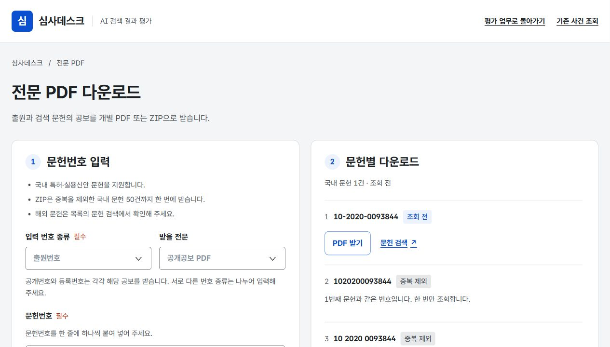

# UX 라이팅 점검안 적용 결과

적용일: 2026-10-27. 사용자가 앞선 점검안 전체의 적용을 요청해, 기존 KRDS 수정 사항을 대조하고 남아 있던 문구와 상호작용을 반영했다. 기존 KIPRIS Plus 조회·공보 PDF API와 평가 업무 규칙을 유지했다.

기준은 사용자가 지정한 [Toss ux-writing SKILL.md](https://github.com/toss/apps-in-toss-harness/blob/main/packages/agent-plugin/shared/skills/ux-writing/SKILL.md)다. 업무 명칭과 실제 특허 원문, PDF·ZIP·CPC 등 식별에 필요한 용어는 유지했다. 한국어 화면은 합니다·주세요 어투로 정리했다.

## 최초 점검 12개 항목

| 항목 | 적용 결과 |
|---|---|
| 1. 잘못된 번호에서 다른 전문 표시 | 입력한 번호와 오류를 그대로 표시하고 다시 조회하도록 안내한다. 샘플은 명시적으로 선택할 때만 연다. |
| 2. 표기 차이에 따른 중복·ZIP 덮어쓰기 | 번호 종류와 정규화 번호로 중복을 제외하고 같은 파일을 한 번만 요청·추가한다. |
| 3. 저장 충돌 후 입력 손실 | 실패 시 편집값을 유지한다. 현재 입력을 보관할 파일을 제공하고, 입력을 버리는 새로고침에는 그 결과를 명시한다. 자동 병합은 제공하지 않는다. |
| 4. 자료 수집 왕복 중 작업 위치 초기화 | PDF·사건 자료를 새 창으로 열어 부모 화면의 편집값을 유지한다. 사용자·운영월·메뉴·선택 출원 등 위치를 같은 탭에서 복원한다. |
| 5. 해외 문헌이 국내 수집 차단 | 국내·해외·형식 오류·중복을 행별로 구분한다. 국내 수집을 계속 허용하고 해외 문헌에는 검색 링크를 제공한다. |
| 6. AI 전담자의 잘못된 첫 메뉴 | 선택한 사용자의 역할에 따라 담당 업무로 진입한다. |
| 7. 키보드로 사용자 선택 불가 | 이름을 실제 버튼으로 제공하고 선택 상태·표 제목을 전달한다. 위치에 의존하던 ‘오른쪽’ 설명을 제거했다. |
| 8. 효과 없는 ZIP 중단 버튼 | 수집·압축·저장 단계를 구별한다. 취소 후 파일을 쓰지 않도록 검사하고, 취소할 수 없는 최종 저장 단계에는 중단 버튼을 표시하지 않는다. |
| 9. 마감 월 설정·오류 복구 | 마감한 월의 설정을 잠그고 재개방 경로를 제공한다. 마감·기한·변경 충돌의 안내를 구별한다. |
| 10. 원문 PDF와 읽기 화면 출력 혼동 | ‘읽기 화면 인쇄·PDF 저장’으로 구별하고 공개·등록공보 원문 PDF 받기를 별도로 제공한다. |
| 11. 사라지는 오류·기술 진단 | 조회 오류를 지속 표시하고 재시도 경로를 제공한다. 서버 설정·영문 네트워크·JSON·파일 경로 등 진단은 한국어 작업·복구 안내로 바꿨다. |
| 12. 반복 PDF 버튼의 불분명한 이름 | 문헌번호·공보 종류·받기 동작을 접근성 이름에 포함했다. |

이 항목들의 앞선 구현·검증 기록은 [KRDS UI·UX 수정 결과](KRDS_UI_UX_IMPLEMENTATION.md)에 있다.

## 이번에 보완한 문구와 상태

| 화면 | 반영 내용 |
|---|---|
| 평가·관리자 | 공개 상태와 비교 방식 수에 맞는 순위 선택지만 제공한다. 다른 방식이 선택한 순위는 이유와 함께 비활성화한다. 비교 대상 변경으로 기존 값이 무효가 되면 값을 보존하면서 ‘다시 선택해 주세요’로 표시한다. 평가 제외한 방식을 다시 포함할 수 있다. |
| 평가 저장 | 저장 성공과 평가 완료를 구별한다. 남은 문헌 수, 공개 대기 AI, 미완료 품질 순위를 실제 상태에 따라 안내한다. |
| 선정·결과 공개·운영 | 성공 안내에 운영월·출원 수·문헌 수와 다음 작업을 표시한다. 초안 저장 후에는 이전 공개 결과가 계속 보이는 경우를 구별한다. 기한·상한 조건을 각 입력 곁의 별도 행으로 나눴다. |
| 빈 목록·버튼 | 업무 자체가 없을 때와 필터 결과가 없을 때를 구별하고 전체 업무 보기·담당 배정 문의 경로를 제공한다. 추가·삭제·엑셀 저장·입력 보관 버튼을 결과 중심으로 정리했다. |
| PDF 입력 | 지원 범위·최대 50건·해외 대안을 입력 전에 나눠 안내한다. 번호 종류 미선택 상태에 ‘국내 문헌 0건’을 표시하지 않는다. 가져오기 알림과 반복 조건 설명을 줄였다. |
| 파일 처리 | 조회 전·수집 완료·개별 파일 저장·다운로드 요청·실패를 구별한다. 실제 파일을 쓴 경우에만 저장 완료로 안내하며 브라우저 다운로드 요청을 완료 저장으로 표현하지 않는다. 성공·안내·오류의 문구·색·알림 역할을 구별한다. |
| PDF 오류 | 출원 조회 결과 없음과 PDF 미제공을 구별한다. 입력·권한·요청 제한·시간 초과·저장 오류에 맞는 다음 행동을 제공한다. ZIP 결과 파일의 번호·공보 종류도 한국어로 표시한다. |
| 기존 사건 조회 | 영어 장식 라벨과 내부 저장소·연결 방식 명칭을 제거했다. 로딩 안내를 실제 초기 조회 범위에 맞췄다. 패밀리 미조회 결과를 존재하지 않는다는 단정과 구별했다. |
| AI 요약 | 생성 버튼을 누를 때 요약을 생성한다. 저장된 요약 조회와 새 요약 생성을 구별하고, 기존 요약이 있어도 재생성 실패를 표시한다. |
| 전문 읽기·자료 묶음 | 검색 건수가 초록·명세서·청구항 전체 항목 기준이며 독립항 표시 필터와 별개임을 안내한다. 0건일 때 검색어 변경을 안내한다. ZIP에 포함하는 데이터와 별도로 받는 원문 PDF를 현재 기능대로 설명한다. |

앞서 보완한 접근 가능한 대화상자, 모바일 조작 크기·가독성, 메뉴·탭 선택 상태, 선정 당시 담당 출원 접근도 유지했다. 고정 업무 명칭과 API 내부 식별자는 변경하지 않았다.

## 검증 결과

- TypeScript 전체 검사와 지원 Node 24.19의 프로덕션 빌드 통과.
- 평가 규칙, 비교 수별 순위 선택·재포함·무효값 보존, 세션·역할·충돌 복구 테스트 통과.
- PDF 작업 회귀 12개 통과: 정규화·혼합 입력·파일명·취소·저장·HTTP 오류 안내 포함.
- 전문 조회 분기·명시적 샘플·기술 진단 미노출 테스트 통과.
- 분리된 `.wrangler/ux-writing-apply` 가상 자료로 브라우저 검증: 점수 미선택 1문헌 저장 후 남은 작업 1건 안내, 비교 3개→2개 변경 시 무효 3위 표시, 평가 제외한 방식의 재포함 확인.
- PDF 화면에서 번호 종류 선택 전 0건 오해 제거, 선택 후 국내 1건·중복 2건·해외 1건 및 국내 ZIP 버튼 확인.
- 잘못된 출원번호 `123`을 입력한 전문 화면이 다른 샘플을 열지 않고 오류·다시 조회 경로를 표시함을 확인.
- 375px 화면에서 긴 한국어 안내·선택 입력을 확인했다. 페이지 가로 넘침이 없고 선택 입력 높이는 48px이다. 데스크톱 PDF 버튼은 최소 49px로 측정했다.

실기기와 화면 읽기 프로그램을 사용한 사용성 검증은 별도로 실시하지 않았다. 이번 변경은 로컬 코드에 적용했으며 공개 배포는 수행하지 않았다.

[375px 화면 확인 이미지](ux-writing-pdf-mobile.png)
